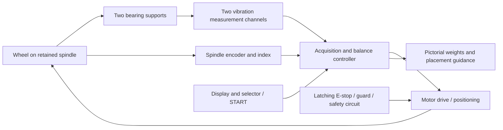
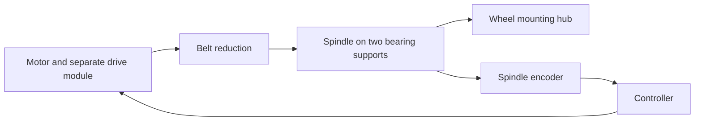

# Mini tyre/wheel balancer

Status: concept study, 2026-10-23. A separate side project kept in the NVH repository. No machine, firmware, component selection or physical qualification is delivered here. Existing logger stages and open acceptance gates retain their own scope.

## Intended machine

Mount a removed tyre/wheel assembly on a dedicated spindle, close the guard, select wheel geometry and press a physical START button. The motor spins the wheel; rotation and vibration measurements produce a pictorial correction estimate. The machine slows and positions the selected correction point at a fixed installation pointer, then permits safe access to fit the weight. Repeat the measurement to verify the correction. No SD card logging is required: process samples in bounded RAM, retaining calibration/settings in nonvolatile storage. Optional serial diagnostics are development aids.

Assumption to resolve before mechanical design: a removed passenger-car wheel is the eventual target; initial experiments use a small purpose-built rotor. Wheel mass, diameter, width, mounting interface, correction radii, available space/power and desired residual tolerance are unknown. “Mini” describes the controller/footprint ambition, not an established safe wheel capacity.

## Architecture



| Function | Proposed direction | Decision gate |
|---|---|---|
| Controller | ESP32 for acquisition, computation and UI | Demonstrate synchronous sampling and bounded control latency; it is not the safety controller |
| Rotation | Encoder on the wheel spindle, with index; Hall or optical index possible | Direction, angular resolution, zero-speed position and index-loss handling tested |
| Vibration | Two independently useful channels at separated bearing supports | Demonstrate sensitivity to both correction planes; a single six-axis board is not automatically two independent planes |
| Existing GY-521 | Candidate for small-rotor learning experiments | Noise, bandwidth, mounting and repeatability must qualify it before gram estimates |
| Drive | Speed-controlled motor with controlled deceleration and low-speed positioning | Size from measured inertia, torque, stop energy and duty; no motor/power/RPM selected yet |
| Mechanics | Retained spindle, repeatable hub fixture, bearings, rigid base and containment | Mechanical design review before any full-wheel spin |
| Operator interface | Graphical display, selector, START and separate STOP; large latching mushroom E-stop | Readable geometry/plane selection and unmistakable motion/fault states |
| Position holding | Mechanical restraint or suitably engineered brake | Prevent wheel drift while fitting weights without exposed powered motion |

One pulse per revolution supports steady-speed phase measurement. It cannot resolve arbitrary angle or reverse motion at rest: use a spindle encoder or equivalent angle sensor for positioning. A motor encoder alone is insufficient if a belt can slip. Freeze index zero, viewing side, rotation sign and the fixed application pointer in one documented coordinate convention.

## Angle sensing: options and provisional direction

One suitable spindle encoder can provide angle, direction and speed. Separate accelerometers measure vibration; guard and safety sensors serve different functions. Multiple rotation sensors are optional, not an established requirement, and extra sensors do not automatically provide independent safety protection.

| Method | Capability | Limitation / research needed |
|---|---|---|
| Single Hall switch and magnet | Once-per-revolution phase reference and RPM | Cannot resolve angle between pulses at standstill |
| Single optical mark | Once-per-revolution phase reference and RPM; related to existing optical experiments | Mark contrast, contamination and edge timing; insufficient alone for positioning |
| Quadrature encoder with index (A/B/Z) | Tracks movement and direction through stopping | Needs a reference operation after startup; detect lost counts |
| Absolute magnetic encoder | Reports angle at rest and during motion | Magnet alignment, air gap, eccentricity, stray fields, latency and accuracy need qualification |
| Absolute optical encoder | Reports coded angular position | Disc alignment, enclosure, contamination and mechanical integration need evaluation |

Provisional direction: an absolute magnetic encoder at the rear of the wheel spindle, potentially with both absolute serial and incremental outputs. Reserve CAD space for a retained magnet, stationary sensor board, alignment adjustment and cover. A compatible device is not selected. Check actual accuracy separately from bit resolution, including installation error and dynamic delay. The AS5047P datasheet in Sources illustrates an interface architecture, not an approved BOM item.

## Spin drive: options and provisional direction

Evaluate a servo-controlled motor driving a dedicated wheel spindle through a belt. Here servo means feedback-controlled motion, not a specific motor technology. The wheel loads are carried by spindle bearings; belt tension also loads the spindle and affects bearing/support design. The encoder measures the wheel spindle directly, even if the motor has its own feedback.



| Arrangement | Reason to consider | Tradeoff to research |
|---|---|---|
| Belt-driven servo | Flexible layout, selectable ratio, spin and indexing with one drive | Belt forces, compliance, transmission vibration and tension repeatability |
| Direct-drive servo | Fewer transmission components | Motor/spindle integration, torque requirements and transmitted motor disturbance |
| Retractable tyre-contact roller | Can disengage for measurement | Slip, tyre deformation, contact force and re-engagement for indexing |
| Separate spin and indexing drives | Independently optimised operating modes | Additional coupling/clutch, engagement state, backlash and control complexity |

Normal cycle: smooth acceleration → stable-speed measurement or qualified coast-down → controlled deceleration → slow indexing → verified standstill and restraint before access. Compare powered and coast-down acquisition experimentally. With a permanently connected belt, a coasting wheel still turns the motor/transmission; zero commanded torque does not remove their mechanical disturbance.

Initially evaluate a separate motor-drive module, leaving the custom PCB responsible for sensing, UI and commands. Motor technology, supply voltage, power, ratio, braking arrangement and operating RPM remain open. Size using wheel/fixture inertia, target angular acceleration, friction/transmission loads, peak and continuous torque, duty cycle, stopping energy and stable load-inertia capability. At the spindle, acceleration torque is approximately J × angular acceleration plus load torque; stored rotational energy is ½ J × angular speed². Refer quantities through the chosen transmission before motor selection. Do not size from wheel mass or nominal watts alone.

## Research register and open questions

All items below are open. The provisional directions above are hypotheses to evaluate, not completed research or authority to fabricate/operate a machine. Record each resolution with dated sources, assumptions, calculations, design revision and, where needed, measured evidence. Datasheet review, simulation and physical qualification are separate evidence types.

| ID / research area | Explicit open questions | Evidence needed to close the decision |
|---|---|---|
| R01 — Target and accuracy | Passenger-car wheels only? Maximum mass, diameter, width and inertia? Hub interfaces? Required residual balance, gram increments, angular accuracy and cycle time? | Agreed requirements sheet and representative wheel/fixture dimensions and inertia estimate with uncertainty |
| R02 — Spindle and retention | Horizontal layout? Bearing spacing/type? Hub-centric or other adapters? How is clamping verified? Permitted runout and remount variation? | CAD options, load/deflection calculations, tolerance drawings, retention review and later measured runout/remount results |
| R03 — Drive architecture | Belt, direct or roller? One drive or separate indexing? Which motor technology and feedback? Is disengagement worth its complexity? | Comparative layout, disturbance/control analysis and small-rig trial results |
| R04 — Powertrain sizing | Measurement/indexing speeds? Acceleration and stop times? Belt ratio/tension? Peak/RMS torque, thermal duty, reflected inertia and supply capacity? | Inertia/load model, motion profile and documented motor/drive operating-envelope checks |
| R05 — Stopping and access | Where does braking energy go? What occurs on power loss, failed drive or broken belt? How is standstill established and drift prevented? | Competent safety assessment, stop/brake/guard architecture, energy calculations and later worst-case stop/fault measurements |
| R06 — Angle sensing | Absolute magnetic or A/B/Z? Accessible shaft end? Required accuracy, update rate, latency and cable interface? How are lost index/counts or magnet faults detected? | Datasheet/interface comparison, CAD alignment budget and measured static/dynamic angle errors against an independent reference |
| R07 — Vibration sensing | Are two bearing-mounted accelerometers sufficiently sensitive and independent? Is the GY-521 adequate, or are other accelerometer/force-sensing arrangements needed? | Noise/bandwidth/timing budget and controlled trial-mass response, cross-coupling, saturation and repeatability evidence |
| R08 — Acquisition and drive interference | Powered or coast-down measurement? How much do motor, belt and bearings contribute at 1×? What sampling/filter delay corrections are necessary? | Common-timebase design, frequency/order analysis, speed-dependent phase checks and powered/coasting comparison |
| R09 — Calibration and validity | Can calibration be reused across wheel sizes/remounts? Which trial masses/radii are effective? When is the two-plane matrix too ill-conditioned? | Synthetic solver checks, controlled two-plane trials, uncertainty/rejection rules and blind known-mass verification |
| R10 — Machinery protection | What containment, guard locking, independent overspeed protection and emergency-stop architecture are required for the intended use? | Risk assessment and specialist design review followed by documented inspection and fault validation; applicability/compliance assessment remains open |
| R11 — Electronics and PCB | Which controller/sensor interfaces and power rails? Cable lengths and grounding? Separate sensor boards? Which drive commands/status and safety monitoring signals? | Block diagram, power/noise budget, interface table, schematic review and later board/harness bring-up with motor running |
| R12 — CAD and manufacture | Which CAD/EDA tools and fabrication methods? Material, tolerances, mounting, enclosure/cooling and service access? | Agreed source/export workflow, coordinated CAD/PCB assembly, reviewed drawings/BOM and fabrication readiness record |
| R13 — Operator guidance | Which viewing side and pointer? How are inner/outer planes, rounded masses, uncertain results and next-plane positioning presented? | Labelled interface prototype, coordinate tests and observed workflow checks before enabling motion |
| R14 — Independent validation | What reference machine/method is available? How will residual balance, repeatability and indexing error be measured? What are pass/fail limits? | Written validation protocol with independent reference capability and agreed thresholds before acceptance trials |

Next research package: resolve R01 requirements first, then develop R02/R03 mechanical options and R06/R07 sensing budgets together. These feed R04 sizing, R05/R10 safety design and R11 PCB interfaces. Begin offline calculation tests without waiting for hardware selection. Do not treat unresolved questions as default specifications.

## Measurement and calibration

Extract the vibration component synchronous with one wheel revolution (1×), including amplitude and phase relative to the index. Timestamp acquisition and encoder events on a common timebase; account for sensor/filter delay. Average multiple stable revolutions and reject missing phase references, clipping, unstable speed, insufficient signal and nonrepeatable readings. Motor, belt, bearings, fixture runout and structural resonances can contaminate results; qualify the selected measurement speed and drive strategy experimentally.

Begin with a single-plane trial rotor, then extend to two-plane dynamic balancing for a tyre/wheel. A single-plane demonstration cannot establish that couple imbalance is corrected.

For a single plane, represent vibration as complex V and trial unbalance as U_t = m_t r_t exp(i theta_t). Baseline V0 and trial reading Vt give alpha = (Vt - V0) / U_t and correction Uc = -V0 / alpha. The added correction mass is |Uc| / correction_radius; its angle is arg(Uc) under the calibrated convention. Remove the trial mass before applying that correction, or explicitly account for it. Do not derive grams directly from acceleration alone or assume the vibration peak identifies the heavy point.

For two planes, take a baseline and separate known-trial runs in each plane. Build the complex 2×2 influence matrix from the two measurement channels and solve A Uc = -V0. Reject weak/ill-conditioned calibration rather than displaying a plausible mass. Calibration validity depends on speed, geometry, fixture, sensor setup and repeatability; investigate how much can be reused across wheels before offering a saved machine calibration.

Enter correction radius for each plane and axial plane locations/spacing. Show raw estimate and practical weight increment separately; evaluate the rounded correction by a verification spin. Numerical confidence, gram resolution, angular tolerance and residual acceptance thresholds must come from experiments, not display precision.

## Pictorial display and operation

Show a wheel face with a highlighted ADD-WEIGHT point, current angle, target angle and fixed installation pointer. Pair it with a rim cross-section highlighting INNER or OUTER correction plane. Label the viewing side so the picture cannot silently mirror the physical wheel. Show grams, selected radius, measurement quality and residual after verification.

Illustrative screen only — these are not measured results:

```text
INNER PLANE     Estimated ADD 15 g
[wheel face: target dot -> fixed 12 o'clock pointer]
[rim section: INNER highlighted | OUTER dim]
Position: moving / aligned / safely restrained
NEXT: fit weight, close guard, press START to verify
```

At the end of a valid spin, automatically decelerate and index the first correction point with the guard closed. Verify standstill and restraint before permitting access. Selecting the next plane requests a new positioning cycle only after access is closed and a deliberate motion command is given. Never move automatically while someone is fitting a weight. Invalid measurements suppress correction positioning and explain the reason.

Proposed lifecycle: SETUP → READY → ACCELERATE → MEASURE → DECELERATE → INDEX → RESTRAINED/ACCESS → VERIFY. Any fault enters an appropriate safe-stop state. Emergency-stop release, power recovery and guard closure must never restart motion by themselves. Separate calibration and diagnostic modes from the normal operator workflow.

## Emergency stop and mechanical protection

The large slam button is a latching mushroom emergency stop acting through an independently engineered safety circuit, not solely an ESP32 input or display command. Its reset only permits a subsequent deliberate restart. The circuit must address guard interlocks, motor torque, stopping/braking behaviour, power failure and relevant faults; select its architecture and required safety performance through a competent machinery risk assessment.

Removing motor power does not remove stored wheel energy. Determine safe stopping behaviour, measure run-down and hold the guard locked until safe standstill where required. Provide suitable containment for wheel/weight ejection, retained wheel mounting, guarded belt/pinch points and an isolator for maintenance. Define overspeed protection and safe speed/inertia limits before powered trials. A software speed limit alone is not a demonstrated independent protective function.

This section is a design requirement, not an approved safety circuit or a claim of regulatory compliance. All uploads and physical operation remain in the separate user hardware workflow.

## Mechanical CAD and circuit-board development

Both are required project workstreams, developed together with sensing, control software and safety engineering. CAD/EDA applications and fabrication suppliers are not selected yet; no new software dependencies or purchases are authorised by this concept update.

### Mechanical CAD

Develop a parametric assembly covering the base/frame, spindle, bearings and supports, wheel centring/retention adapters, motor mount/transmission, encoder target and bracket, sensor mounting faces, brake/restraint, guard/containment, enclosure, display and controls. Include wheel loading/removal clearance, weight-fitting access, cable routing, strain relief and maintenance access. Locate the emergency stop within easy reach.

Define datums and tolerances for spindle runout, bearing alignment, wheel remount repeatability and sensor orientation. Assess stiffness, vibration modes, mounting loads, maximum wheel inertia, drive torque, braking loads and containment requirements. Record calculations and assumptions; a CAD model or simulation alone does not establish physical safety or measurement accuracy.

Deliver editable assembly/part sources, neutral STEP exports, dimensioned manufacturing/assembly drawings, material/fastener specifications, mechanical BOM and an interface drawing shared with PCB development. Fabrication gate: reviewed capacity/load/stop assumptions, clearances, retention, guards, tolerances and assembly procedure. As-built dimensional and runout checks remain separate evidence.

### Electronics and PCB

Develop the system block diagram, power budget, connector/pin schedule, wiring harness drawings and schematics before layout. Cover controller, encoder inputs, vibration acquisition interfaces, display/selector/buttons, motor-drive command/status, brake interfaces, guard/safety status feedback and service/debug connections. Evaluate whether sensors need local boards near the bearings rather than mounting them on the control PCB.

Define supply rails, logic levels, grounding/shielding, sensor timing interfaces, cable lengths, connector keying, input protection, fusing, transients, motor interference and thermal/current limits. Select the motor drive and power/safety architecture before assigning power-stage PCB requirements; do not assume the controller board will carry motor current or mains voltage.

Keep the independently engineered emergency-stop/guard safety function outside ordinary firmware control. The PCB may monitor safety status; monitoring does not replace the safety function. Any safety-related electronics require their own architecture review and validation.

Deliver editable schematic/layout sources and libraries, annotated PDF schematics, BOM with manufacturer part identities and substitution constraints, connector/harness tables, assembly drawings, fabrication outputs (Gerbers and drill files), placement files where applicable, and a test-point/bring-up procedure. Fabrication gate: electrical rules and design rules checked, footprints/pinouts verified against selected part documentation, power/thermal/noise review and mechanical fit review completed. Board bring-up, acquisition noise/timing, drive interference and fault response need measured evidence after fabrication.

### Shared interfaces and file organisation

Keep this side project under `side-projects/wheel-balancer/`. Add `cad/`, `electronics/`, `firmware/` and `verification/` when actual sources or evidence exist. Keep editable design sources versioned alongside revision-matched exports; avoid empty placeholder projects. Maintain separate mechanical and PCB revision identifiers and record which revisions were assembled/tested.

Before either design is released for fabrication, agree the enclosure envelope, board outline, mounting holes, connector positions, display/button cut-outs, cable bend space, cooling, sensor axes and spindle/index coordinate convention. Exchange a PCB STEP model with the mechanical assembly and check fit/access. Revise drawings and harness tables together when interfaces change.

## Development sequence and evidence gates

1. Freeze target wheel envelope, mounting concept, operator workflow, coordinate convention and risk assessment. Develop initial mechanical CAD, electronics architecture and their shared interface drawing. Select no powertrain until inertia/stop/containment requirements are established.
2. Offline mathematics with synthetic vectors: known mass/angle recovery, radius changes, sign/mirroring, two-plane coupling, singular/noisy calibration, rounding and rejected data. No motor required.
3. Review and fabricate the small-rotor CAD and prototype electronics under the workstream gates above. Separate small-rotor rig: qualify encoder and vibration acquisition, timing, repeatability and known trial-mass detection. Establish a safe rig-specific speed envelope through mechanical review.
4. Single-plane calibration and pictorial guidance; verify with blind known added masses and repeated remounts. Report errors and residuals.
5. Two-plane sensing/calibration and independent verification of static and couple corrections. Establish useful uncertainty and gram/angle limits.
6. Guarded motor control, fault response, stop/standstill and automatic indexing with recorded position error and repeatability. Fault-inject lost index, stalled motor, sensor failure, reboot, E-stop and guard requests.
7. Full-wheel progression only after mechanical/safety review and preceding gates. Compare repeatability and residual correction with an independent qualified wheel-balancing reference. Bench results do not establish roadworthiness or release acceptance.

Immediate next design deliverable: target-wheel requirements, initial CAD assembly layout, electronics block diagram and shared mechanical/electrical interface drawing, alongside a dependency-free offline calculation model. No purchase list or energized wiring specification yet.

## Sources

- [Brüel & Kjær, Static and Dynamic Balancing](https://www.bksv.com/media/doc/17-227.pdf): trial-weight vectors and coupled two-plane correction.
- [UiTM experimental single/two-plane study](https://ir.uitm.edu.my/id/eprint/17643/): influence-coefficient experiments with known trial masses.
- [HSE machinery safety introduction](https://www.hse.gov.uk/work-equipment-machinery/introduction.htm): guarding, access control, isolation and emergency controls.
- [Machinery safety regulations, Annex I](https://www.legislation.gov.uk/uksi/2008/1597): emergency-stop reset must not restart machinery; emergency stops supplement safeguarding. Applicability and current compliance need assessment for the eventual build/use.

- [AS5047P manufacturer datasheet](https://look.ams-osram.com/m/d05ee39221f9857/original/AS5047P-DS000324.pdf): example absolute SPI plus incremental encoder architecture.
- [TI encoder overview](https://www.ti.com/document-viewer/lit/html/SSZTC91/GUID-9AA0DC8B-AEEF-430B-B1B0-EC40E48EE2E5): incremental versus absolute position feedback.
- [Motor-sizing calculation guidance](https://www.orientalmotor.com.sg/sg/tech/calculation/sizing-motor04): acceleration/load torque and effective duty calculations; does not select a motor for this machine.
