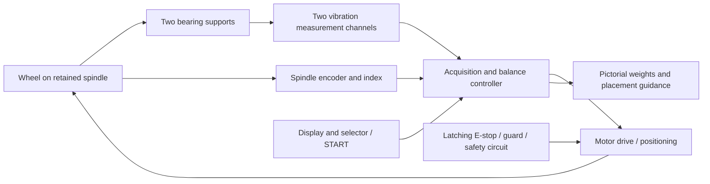

# Mini tyre/wheel balancer

Status: concept study, 2026-10-23. A separate side project kept in the NVH repository. No machine, firmware, component selection or physical qualification is delivered here. Existing logger stages and open acceptance gates retain their own scope.

## Intended machine

Mount a removed tyre/wheel assembly on a dedicated spindle, close the guard, select wheel geometry and press a physical START button. The motor spins the wheel; rotation and vibration measurements produce a pictorial correction estimate. The machine slows and positions the selected correction point at a fixed installation pointer, then permits safe access to fit the weight. Repeat the measurement to verify the correction. No SD card logging is required: process samples in bounded RAM, retaining calibration/settings in nonvolatile storage. Optional serial diagnostics are development aids.

Assumption to resolve before mechanical design: a removed passenger-car wheel is the eventual target; initial experiments use a small purpose-built rotor. Wheel mass, diameter, width, mounting interface, correction radii, available space/power and desired residual tolerance are unknown. “Mini” describes the controller/footprint ambition, not an established safe wheel capacity.

## Architecture



| Function | Proposed direction | Decision gate |
|---|---|---|
| Controller | ESP32 for acquisition, computation and UI | Demonstrate synchronous sampling and bounded control latency; it is not the safety controller |
| Rotation | Encoder on the wheel spindle, with index; Hall or optical index possible | Direction, angular resolution, zero-speed position and index-loss handling tested |
| Vibration | Two independently useful channels at separated bearing supports | Demonstrate sensitivity to both correction planes; a single six-axis board is not automatically two independent planes |
| Existing GY-521 | Candidate for small-rotor learning experiments | Noise, bandwidth, mounting and repeatability must qualify it before gram estimates |
| Drive | Speed-controlled motor with controlled deceleration and low-speed positioning | Size from measured inertia, torque, stop energy and duty; no motor/power/RPM selected yet |
| Mechanics | Retained spindle, repeatable hub fixture, bearings, rigid base and containment | Mechanical design review before any full-wheel spin |
| Operator interface | Graphical display, selector, START and separate STOP; large latching mushroom E-stop | Readable geometry/plane selection and unmistakable motion/fault states |
| Position holding | Mechanical restraint or suitably engineered brake | Prevent wheel drift while fitting weights without exposed powered motion |

One pulse per revolution supports steady-speed phase measurement. It cannot resolve arbitrary angle or reverse motion at rest: use a spindle encoder or equivalent angle sensor for positioning. A motor encoder alone is insufficient if a belt can slip. Freeze index zero, viewing side, rotation sign and the fixed application pointer in one documented coordinate convention.

## Measurement and calibration

Extract the vibration component synchronous with one wheel revolution (1×), including amplitude and phase relative to the index. Timestamp acquisition and encoder events on a common timebase; account for sensor/filter delay. Average multiple stable revolutions and reject missing phase references, clipping, unstable speed, insufficient signal and nonrepeatable readings. Motor, belt, bearings, fixture runout and structural resonances can contaminate results; qualify the selected measurement speed and drive strategy experimentally.

Begin with a single-plane trial rotor, then extend to two-plane dynamic balancing for a tyre/wheel. A single-plane demonstration cannot establish that couple imbalance is corrected.

For a single plane, represent vibration as complex V and trial unbalance as U_t = m_t r_t exp(i theta_t). Baseline V0 and trial reading Vt give alpha = (Vt - V0) / U_t and correction Uc = -V0 / alpha. The added correction mass is |Uc| / correction_radius; its angle is arg(Uc) under the calibrated convention. Remove the trial mass before applying that correction, or explicitly account for it. Do not derive grams directly from acceleration alone or assume the vibration peak identifies the heavy point.

For two planes, take a baseline and separate known-trial runs in each plane. Build the complex 2×2 influence matrix from the two measurement channels and solve A Uc = -V0. Reject weak/ill-conditioned calibration rather than displaying a plausible mass. Calibration validity depends on speed, geometry, fixture, sensor setup and repeatability; investigate how much can be reused across wheels before offering a saved machine calibration.

Enter correction radius for each plane and axial plane locations/spacing. Show raw estimate and practical weight increment separately; evaluate the rounded correction by a verification spin. Numerical confidence, gram resolution, angular tolerance and residual acceptance thresholds must come from experiments, not display precision.

## Pictorial display and operation

Show a wheel face with a highlighted ADD-WEIGHT point, current angle, target angle and fixed installation pointer. Pair it with a rim cross-section highlighting INNER or OUTER correction plane. Label the viewing side so the picture cannot silently mirror the physical wheel. Show grams, selected radius, measurement quality and residual after verification.

Illustrative screen only — these are not measured results:

```text
INNER PLANE     Estimated ADD 15 g
[wheel face: target dot -> fixed 12 o'clock pointer]
[rim section: INNER highlighted | OUTER dim]
Position: moving / aligned / safely restrained
NEXT: fit weight, close guard, press START to verify
```

At the end of a valid spin, automatically decelerate and index the first correction point with the guard closed. Verify standstill and restraint before permitting access. Selecting the next plane requests a new positioning cycle only after access is closed and a deliberate motion command is given. Never move automatically while someone is fitting a weight. Invalid measurements suppress correction positioning and explain the reason.

Proposed lifecycle: SETUP → READY → ACCELERATE → MEASURE → DECELERATE → INDEX → RESTRAINED/ACCESS → VERIFY. Any fault enters an appropriate safe-stop state. Emergency-stop release, power recovery and guard closure must never restart motion by themselves. Separate calibration and diagnostic modes from the normal operator workflow.

## Emergency stop and mechanical protection

The large slam button is a latching mushroom emergency stop acting through an independently engineered safety circuit, not solely an ESP32 input or display command. Its reset only permits a subsequent deliberate restart. The circuit must address guard interlocks, motor torque, stopping/braking behaviour, power failure and relevant faults; select its architecture and required safety performance through a competent machinery risk assessment.

Removing motor power does not remove stored wheel energy. Determine safe stopping behaviour, measure run-down and hold the guard locked until safe standstill where required. Provide suitable containment for wheel/weight ejection, retained wheel mounting, guarded belt/pinch points and an isolator for maintenance. Define overspeed protection and safe speed/inertia limits before powered trials. A software speed limit alone is not a demonstrated independent protective function.

This section is a design requirement, not an approved safety circuit or a claim of regulatory compliance. All uploads and physical operation remain in the separate user hardware workflow.

## Development sequence and evidence gates

1. Freeze target wheel envelope, mounting concept, operator workflow, coordinate convention and risk assessment. Select no powertrain until inertia/stop/containment requirements are established.
2. Offline mathematics with synthetic vectors: known mass/angle recovery, radius changes, sign/mirroring, two-plane coupling, singular/noisy calibration, rounding and rejected data. No motor required.
3. Separate small-rotor rig: qualify encoder and vibration acquisition, timing, repeatability and known trial-mass detection. Establish a safe rig-specific speed envelope through mechanical review.
4. Single-plane calibration and pictorial guidance; verify with blind known added masses and repeated remounts. Report errors and residuals.
5. Two-plane sensing/calibration and independent verification of static and couple corrections. Establish useful uncertainty and gram/angle limits.
6. Guarded motor control, fault response, stop/standstill and automatic indexing with recorded position error and repeatability. Fault-inject lost index, stalled motor, sensor failure, reboot, E-stop and guard requests.
7. Full-wheel progression only after mechanical/safety review and preceding gates. Compare repeatability and residual correction with an independent qualified wheel-balancing reference. Bench results do not establish roadworthiness or release acceptance.

Immediate next design deliverable: target-wheel requirements and a mechanical/sensor layout, followed by a dependency-free offline calculation model. No purchase list or energized wiring specification yet.

## Sources

- [Brüel & Kjær, Static and Dynamic Balancing](https://www.bksv.com/media/doc/17-227.pdf): trial-weight vectors and coupled two-plane correction.
- [UiTM experimental single/two-plane study](https://ir.uitm.edu.my/id/eprint/17643/): influence-coefficient experiments with known trial masses.
- [HSE machinery safety introduction](https://www.hse.gov.uk/work-equipment-machinery/introduction.htm): guarding, access control, isolation and emergency controls.
- [Machinery safety regulations, Annex I](https://www.legislation.gov.uk/uksi/2008/1597): emergency-stop reset must not restart machinery; emergency stops supplement safeguarding. Applicability and current compliance need assessment for the eventual build/use.
