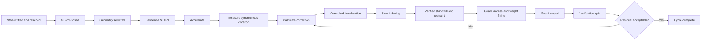
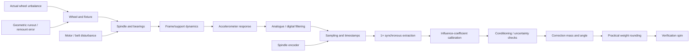
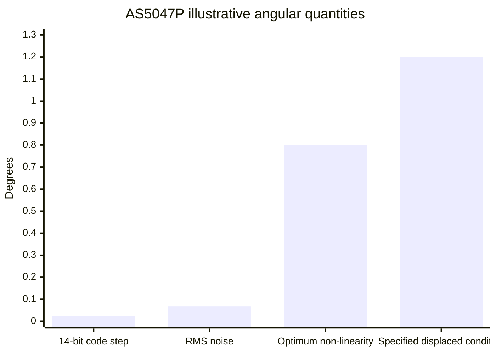
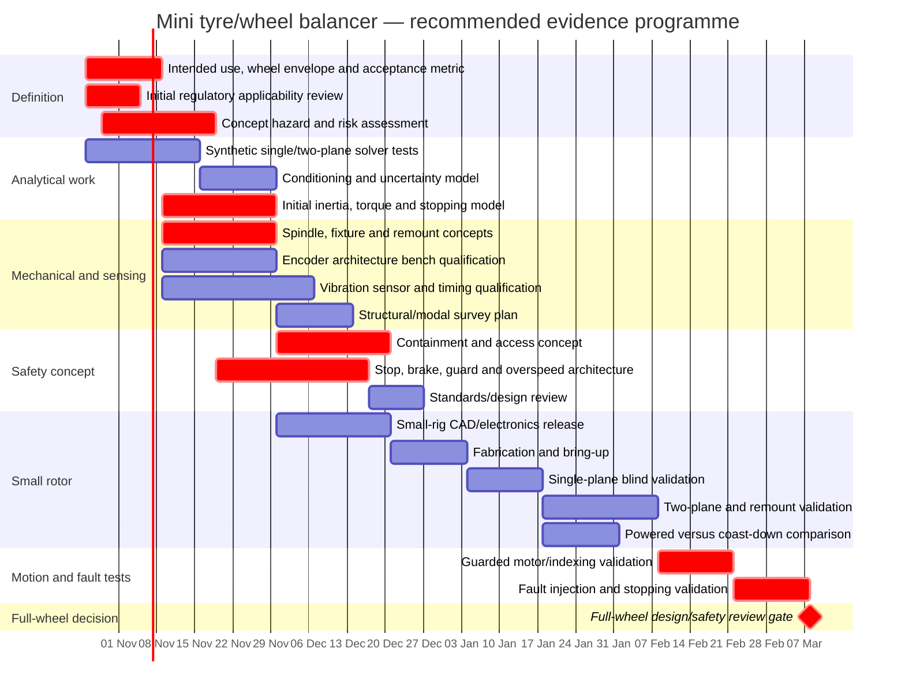

# Deep Research Review of the Mini Tyre/Wheel Balancer Concept

## Executive summary

The attached `README.md`, dated 23 October 2026, is best understood as a **concept-stage engineering research specification**, not as a machine design. It deliberately withholds motor size, operating speed, wheel capacity, sensor qualification, safety architecture, fabrication release and acceptance limits until evidence exists. It explicitly states that all fourteen research-register items remain open and that no machine, firmware, component selection or physical qualification has yet been delivered. That distinction is technically important and credible. fileciteturn0file0

The core balancing concept is sound. The document proposes synchronous extraction of the vibration component at once-per-revolution frequency, measurement of amplitude and phase relative to spindle angle, known trial masses, and—in the eventual wheel application—a complex two-plane influence-coefficient solution. That is consistent with established balancing practice: Brüel & Kjær's balancing application note describes measurements near both rotor bearings, a once-per-revolution reference, separate trial masses in two correction planes, and calculation of plane-specific correction masses and angles. An experimental study by Wan Mohamad, Mat Isa and Ismail likewise used trial masses and the influence-coefficient method for single- and two-plane balancing and reported experimental vibration reduction. citeturn42view5turn37view2

The README's strongest feature is not any particular hardware choice but its **evidence-gated engineering philosophy**. It correctly refuses to infer correction mass directly from raw acceleration, distinguishes one-plane from two-plane balancing, warns that display resolution is not measurement accuracy, requires independent validation, separates ordinary firmware from safety functions, recognises residual stored rotational energy after power removal, and calls for containment and guard locking before full-wheel operation. fileciteturn0file0 Those principles align closely with HSE machinery guidance, which emphasises risk assessment, prevention of access to moving parts, interlocked guarding where necessary, protection against ejected material, safe controls, energy isolation and safe systems of work. citeturn42view0turn42view1

However, **the project is not yet ready for a passenger-car wheel to be spun**. The decisive unknowns are still precisely those that determine both measurement validity and hazard severity: maximum wheel mass and inertia, diameter and width, maximum intended speed, foreseeable unbalance, mounting/retention method, permissible runout, correction radii and plane separation, residual-balance acceptance criterion, structural resonances, required stopping time, containment energy, brake architecture and validation reference. fileciteturn0file0

The highest-priority issue is therefore **requirements and machine limits, not component procurement**. In particular, “mini” should remain a packaging/controller objective and must not become an implicit constraint on the guard, spindle, retention or containment system. A passenger-car wheel can store substantial rotational energy, but no meaningful energy number can yet be calculated because the README intentionally leaves wheel inertia and operating speed unspecified. The document is correct not to infer this from wheel mass alone. fileciteturn0file0

A second major conclusion concerns UK regulatory scope. Current GB Government guidance for the Supply of Machinery (Safety) Regulations 2008 defines a manufacturer to include a person designing or manufacturing machinery **for their own use**, and “putting into service” includes the first use for its intended purpose in Great Britain. The same guidance contains a specific exclusion for machinery specially designed and constructed for research purposes for temporary use in laboratories. Consequently, a genuinely temporary small-rotor research rig may potentially fall within that exclusion if the facts fit it, but the eventual operational full-wheel machine should **not** assume that exclusion applies. citeturn42view2turn42view3 If the equipment is used at work, PUWER separately requires suitable equipment, risk controls, maintenance, inspection where safety depends on installation, guarding, safe controls and appropriate training. citeturn42view1 This is an applicability finding for engineering planning, not legal advice.

The provisional absolute magnetic encoder direction is also technically reasonable, but the README is especially right to distinguish **resolution from accuracy**. Its illustrative AS5047P has a 14-bit core, corresponding to about 0.022° per nominal code step, yet its datasheet specifies non-linearity of ±0.8° with optimum magnet placement, ±1° across temperature, and ±1.2° under the stated displacement-and-temperature condition; SPI propagation delay is also specified at 90–110 μs. citeturn42view4 A 14-bit number should therefore never be turned directly into an angular-accuracy claim for this machine.

The recommended project sequence is:

**requirements and legal/safety applicability → quantitative hazard and uncertainty budgets → offline solver verification → spindle/fixture/sensor/drive trade studies → safety concept → small-rotor experiments → single-plane validation → two-plane validation → guarded drive/indexing fault tests → only then a full-wheel prototype and comparison with an independent balancing reference.**

The attached README already points broadly in that direction. The principal changes recommended by this review are to make the **risk assessment iterative from the very start**, elevate **mounting/remount repeatability and containment** to first-class metrology/safety workstreams, formalise an **uncertainty budget and matrix-conditioning criterion**, and add an explicit standards review covering both the ISO 21940 balancing family and the machinery-safety standards relevant to risk reduction, interlocking, unexpected start-up, safety-related controls and electrical equipment.

### Overall assessment

| Area | Assessment | Evidence maturity | Main conclusion |
|---|---|---:|---|
| Problem definition | Sensible but incomplete | Low | Passenger-car wheel remains an intended target, not a defined design envelope |
| Balancing mathematics | Fundamentally credible | Medium at theory level; zero project test evidence | Influence-coefficient approach is well-founded; implementation must demonstrate linearity, conditioning and uncertainty |
| Angle sensing | Good architectural reasoning | Low | Absolute spindle sensing is a strong candidate; actual encoder accuracy must be qualified in situ |
| Vibration sensing | Correctly treated as unresolved | Very low | GY-521 is appropriate only as an experiment candidate until proven |
| Drive concept | Plausible options, no premature choice | Very low | Belt servo is a sensible baseline for study but cannot be sized yet |
| ESP32 use | Plausible for ordinary acquisition/UI/control | Low | Hardware-timed acquisition can be feasible, but ESP32 must remain outside the safety function |
| Mechanical metrology | Recognised but under-emphasised | Very low | Hub centring, runout and remount repeatability may dominate achievable wheel-balancing accuracy |
| Safety architecture | Principles are strong; engineering is absent | Very low | No full-wheel spin until retention, containment, stop, access and fault behaviour are designed and validated |
| Regulatory treatment | Cautious but incomplete | Low | Formal GB applicability assessment should be an early gate |
| Validation | Conceptually strong | Zero project data | Independent reference comparison and blind known-mass tests are essential |
| Overall | **Strong research specification; not yet a machine design** | **Concept stage** | Proceed with staged research, not procurement or full-wheel fabrication |

## What the file establishes, and what remains unspecified

### Structure and intent of the document

The file has a coherent systems-engineering structure rather than being merely a collection of component ideas. It proceeds from intended use through architecture, rotation sensing, drive options, a fourteen-item research register, mathematical calibration, operator workflow, emergency-stop and mechanical protection concepts, CAD and PCB workstreams, shared interfaces and a gated development sequence. fileciteturn0file0

Its proposed machine cycle is:



This is a strong workflow concept because it separates **measurement**, **powered positioning**, and **human access** instead of treating them as one control state. The README also requires deliberate commands before subsequent motion and states that guard closure, emergency-stop reset or power recovery must never by themselves cause restart. fileciteturn0file0 HSE guidance similarly calls for safe starting/stopping controls and guarding arrangements that prevent access to moving danger zones; routine-access machinery may require an interlocked guard, sometimes with guard locking until dangerous movement has stopped. citeturn42view0turn42view1

### Explicit technical claims

The main technical propositions are these:

| Proposition in the README | Research assessment |
|---|---|
| A once-per-revolution signal is enough for steady-speed phase reference but not for arbitrary standstill positioning | Correct in principle. A single pulse gives a periodic reference, not continuous shaft angle or direction between events. |
| Wheel-spindle position should be sensed directly when a belt can slip | Strong design principle. It avoids conflating motor angle with wheel angle. |
| Two vibration channels near separate bearing supports are needed for eventual two-plane work | Directionally correct, but the channels should be regarded as two response measurements, not as measurements that inherently correspond one-to-one with the correction planes. Cross-coupling belongs in the influence matrix. |
| A six-axis IMU is not automatically equivalent to two independently useful plane measurements | Correct and important. Independence is a property of the measurement geometry and response matrix, not the number printed in an IMU's axis count. |
| Correction mass should not be inferred directly from acceleration magnitude | Correct. The response includes machine dynamics and therefore requires calibration/influence coefficients. |
| Single-plane success does not demonstrate correction of couple unbalance | Correct. Established balancing literature distinguishes static/single-plane and dynamic/two-plane correction. citeturn42view5turn37view2 |
| Trial runs can identify a two-plane influence matrix | Consistent with established influence-coefficient practice. citeturn42view5turn37view2 |
| An ill-conditioned influence matrix should cause rejection rather than a plausible-looking correction | Excellent principle; it needs a quantitative rejection rule. |
| Powered and coast-down measurement should be compared empirically | Sensible. The permanent transmission can alter vibration in either mode; coast-down also introduces changing rotational frequency and therefore a more demanding signal-processing problem. |
| Motor selection must use inertia, acceleration, load torque, duty and stop energy rather than wheel mass or watts alone | Correct engineering formulation. |
| Removing electrical torque does not remove stored wheel energy | Safety-critical and correct. HSE specifically treats moving machinery, ejected material, isolation and continuing movement as hazards requiring safeguarding. citeturn42view0turn42view1 |
| ESP32 must not constitute the safety controller | Correct architectural boundary. |
| Verification spin is part of the correction process | Strong practice; historical balancing guidance likewise calls for remeasurement after fitting corrections. citeturn42view5 |

### What is deliberately unspecified

The file contains **no measured balancing data**. There are no spectra, vibration amplitudes, trial-weight responses, phase-repeatability figures, runout measurements, residual-unbalance measurements, stopping times, structural natural frequencies, sensor noise distributions or independent-reference comparisons. It therefore would be misleading to graph “performance” from the README. fileciteturn0file0

It also contains no final values for:

- maximum wheel mass, diameter, width or rotational inertia;
- wheel and adapter interface;
- spindle dimensions, bearing specification or bearing spacing;
- maximum speed or normal measurement speed;
- acceleration or deceleration target;
- correction-plane radii and axial spacing;
- maximum anticipated initial unbalance;
- required residual balance;
- required mass increment or angular tolerance;
- correction-cycle time;
- allowable spindle/hub runout;
- remount repeatability;
- motor technology, power, drive voltage or reduction ratio;
- guard material, thickness, geometry or containment rating;
- braking system, energy absorption or stop category;
- safety performance level or integrity requirement;
- encoder model;
- final vibration sensor;
- sample rate;
- analogue or digital sensor topology;
- sensor range, noise floor or phase-delay budget;
- PCB architecture;
- supply architecture;
- acceptance thresholds for any test.

Those omissions are appropriate at the present stage **provided they remain visibly unresolved**. They must not later be replaced by convenience defaults.

The evidence state is therefore stark:

```text
Research-register items explicitly stated open:  ██████████████  14
Research-register items explicitly stated closed:               0
Measured machine-performance datasets:                           0
Selected final motor/drive combinations:                         0
Qualified full-wheel safety envelopes:                           0
```

This is not a criticism; it is the correct maturity description of a concept study. fileciteturn0file0

### Implicit questions hiding behind the explicit register

The fourteen-item register is good, but several deeper questions are implicit rather than fully articulated.

**What exactly constitutes “balanced”?** The README uses concepts such as residual tolerance, gram increment and angular accuracy but does not yet define the acceptance quantity. A displayed correction mass in grams is not itself a residual-unbalance specification. The project needs to distinguish at least correction mass, correction radius, unbalance moment, per-plane residual, machine indication uncertainty and final acceptance threshold.

**Is the wheel/fixture/machine response sufficiently linear for the proposed influence-coefficient calculation?** The equations assume that trial-mass responses superpose sufficiently well within the chosen operating condition. That should be tested with trial masses of different sizes and phases rather than presumed.

**How stable is calibration under remounting?** The document asks whether calibration can be reused between wheels, but a prior question is whether an unchanged wheel produces the same complex measurement after removal and refitting. On a wheel balancer, centring and clamping repeatability can be inseparable from measurement repeatability.

**How strongly does machine structure shape the measurement?** The balance calculation intentionally uses machine response rather than requiring a perfectly rigid structure, but operation near a support/frame resonance can make amplitude and phase exceptionally speed-sensitive. A modal survey or at least an experimental speed sweep should therefore precede selection of a measurement RPM.

**How will trial masses themselves be retained safely?** The mathematical sections specify known trial masses and radii, but a rotating trial mass is also an ejection hazard. Its attachment method needs an explicit load and retention qualification.

**What is the safety function that actually grants access?** The operational encoder can report zero speed to the ESP32, but a guard-lock release is a safety function if opening the guard before safe standstill can expose a hazardous rotating wheel. The design therefore needs to decide what independent or safety-related evidence of standstill is required; ordinary application firmware should not silently become that evidence.

**What happens when measurement and safety objectives conflict?** A mechanically compliant spindle/support can increase measurable vibration, whereas a mechanically stiff structure can improve geometric repeatability and containment. The design needs to optimise the complete transfer function and safety envelope rather than maximise sensor amplitude.

**What is the intended scope relative to tyre uniformity or “road-force” behaviour?** The current architecture measures mass-unbalance response. It does not claim to measure loaded radial-force variation, tyre stiffness non-uniformity or on-vehicle imbalance, which is appropriate. That boundary should become an explicit requirement so the finished machine is not given broader diagnostic claims than it can substantiate.

## Technical assessment of the measurement, sensing and control concept

### Balancing model

The single-plane mathematics in the README is conceptually well formed:

\[
U_t = m_t r_t e^{j\theta_t}
\]

\[
\alpha = \frac{V_t - V_0}{U_t}
\]

\[
U_c = -\frac{V_0}{\alpha}
\]

where the known trial unbalance \(U_t\) changes the measured complex vibration from \(V_0\) to \(V_t\), allowing the influence coefficient \(\alpha\) to be inferred. The correction mass then follows from correction unbalance magnitude divided by the selected correction radius. fileciteturn0file0

For two-plane work, the corresponding formulation is:

\[
\begin{bmatrix}
V_1\\
V_2
\end{bmatrix}
=
\begin{bmatrix}
a_{11} & a_{12}\\
a_{21} & a_{22}
\end{bmatrix}
\begin{bmatrix}
U_1\\
U_2
\end{bmatrix}
\]

and the desired correction is:

\[
\mathbf{U}_c=-\mathbf{A}^{-1}\mathbf{V}_0
\]

or, computationally, a linear solve rather than literally computing the inverse. This is consistent with the established two-plane trial-mass process described in the B&K source: baseline amplitudes/phases are measured, a known mass is placed in one plane, then in the other, and correction masses and angles are derived from the resulting responses. citeturn42view5 The 2015 experimental UiTM paper likewise describes theoretical and experimental single- and two-plane balancing using trial masses and influence coefficients. citeturn37view2

The document's warning about ill-conditioning is particularly important. Even mathematically invertible matrices can produce physically useless corrections when the two columns of the influence matrix are nearly dependent or measurement noise is large relative to the trial response. The project should therefore record, for every calibration:

\[
\kappa(\mathbf A)
\]

together with repeated-run covariance or equivalent uncertainty measures. A threshold for rejection should be determined empirically from synthetic noise tests and physical validation rather than chosen solely because a textbook calls one condition number “large”.

The offline test suite should explicitly include:

- known one-plane and two-plane solutions;
- global sign reversal;
- viewing-side mirroring;
- angle wrapping at 0°/360°;
- unequal correction radii;
- cross-plane coupling;
- trial-mass removal versus retention;
- additive complex noise;
- systematic phase delay;
- missing encoder events;
- sensor clipping;
- speed drift;
- near-singular matrices;
- correction-mass quantisation;
- angular quantisation;
- remount offsets;
- verification after rounded correction.

That software work can begin immediately because it requires no motor, encoder or PCB.

### Measurement-chain error model

A useful way to reorganise the project is to treat the measured complex vibration as the output of a complete chain rather than “what the accelerometer sees”:



Every block above can change amplitude, phase or repeatability. The central research problem is therefore not merely “can two accelerometers detect vibration?” but **whether the whole complex transfer function is sufficiently stable and observable to recover repeatable corrections**.

The README already recognises filter delay, belt/motor interference, fixture runout and structural resonances. fileciteturn0file0 B&K's application note explicitly uses a one-per-revolution phase reference with bearing vibration measurements and discusses filtering around the rotational component, reinforcing the need to preserve phase as well as amplitude. citeturn42view5

### Powered versus coast-down acquisition

The README is right to test both rather than declare one superior. fileciteturn0file0

A **constant-speed powered test** offers a stationary frequency and therefore simpler coherent averaging, phase estimation and calibration. Its disadvantage is that motor electromagnetic forces, belt dynamics, torque ripple and drive control can add synchronous or near-synchronous content.

A **coast-down test** may reduce commanded motor torque but does not automatically isolate the motor when a belt remains connected. It also causes the 1× frequency to change continuously, so ordinary fixed-frequency averaging is no longer equivalent to constant-speed measurement. Robust coast-down processing needs angle-domain resampling, order tracking or sufficiently short speed-normalised windows.

For the first small-rotor implementation, constant-speed measurement should be the **baseline** because it minimises signal-processing ambiguity. Coast-down should then be an A/B experiment intended to answer a specific question: does removal of active motor torque materially improve repeatability or bias? It should not be adopted because “coasting sounds quieter”.

### Spindle angle sensing

The README considers five alternatives and provisionally favours an absolute magnetic sensor directly on the wheel spindle. fileciteturn0file0 That is a defensible concept because balancing needs two somewhat different angle functions:

1. **phase reference during measurement**, and
2. **known angular position at or near standstill for correction placement**.

A one-pulse-per-revolution Hall or optical system satisfies the first at constant speed but not the second without additional estimation. A quadrature encoder handles incremental motion and direction but normally needs a reference process to establish absolute zero after startup. An absolute spindle encoder simplifies the human-facing indexing problem.

The AS5047P example provides an excellent warning against specification-by-bit-count. It has a 14-bit core, so the nominal digital step is:

\[
\frac{360^\circ}{2^{14}}\approx 0.022^\circ
\]

Yet the manufacturer's system specifications give ±0.8° non-linearity at optimum magnet placement at 25 °C, ±1° over the stated temperature range, ±1.2° for the specified displaced-magnet condition and an RMS output noise figure of 0.068°. Its SPI angle path also has a stated 90–110 μs propagation delay. citeturn42view4

The following chart compares magnitudes only; these are **different error/noise quantities and should not be algebraically added as though they were equivalent**.



The implication is not that the AS5047P is unsuitable. It is that final angular performance must include the **sensor plus magnet eccentricity, axial gap, shaft runout, bracket stiffness, assembly tolerance, electrical latency and calibration method**. The README's plan to reserve alignment adjustment and qualify static and dynamic errors against an independent reference is therefore exactly the right direction. fileciteturn0file0

One additional recommendation is to decouple two requirements:

- the **metrology requirement** for vibration phase;
- the **operator-positioning requirement** for locating a correction weight.

The latter may permit considerably looser angle error than the digital sensor can resolve, while the former is sensitive to systematic latency at rotational speed. Keeping separate error budgets prevents unnecessary hardware precision in one function from obscuring phase error in the other.

### Vibration sensing and the GY-521 question

The README treats the existing GY-521 only as a candidate for small-rotor learning, not as an approved final sensor. fileciteturn0file0 That is the only defensible position at present.

Whether it is adequate cannot be decided from nominal accelerometer range alone. The test should establish:

- noise spectral density in the intended mounted configuration;
- useful 1× signal-to-noise ratio;
- bandwidth and filter transfer function;
- phase delay;
- sample-to-sample timing stability;
- cross-axis sensitivity in the installed orientation;
- mechanical mounting resonance;
- motor-drive electrical interference;
- saturation margin;
- channel-to-channel timing skew;
- temperature drift;
- repeatability after remounting the sensor;
- sensitivity to known trial unbalance.

The most revealing metric will not be “RMS acceleration noise” in isolation, but the uncertainty of the **complex 1× vector after the proposed synchronous estimator**, because that is the quantity consumed by the balance solver.

Two bearing sensors should also not be described as “one sensor per correction plane”. Established two-plane methods measure responses at two locations while both correction planes influence both responses. B&K's description explicitly measures the response at both planes after each trial mass. citeturn42view5 The full \(2\times2\) coupling matrix is therefore a feature, not an inconvenience.

### ESP32 feasibility

An ESP32 is plausible for non-safety acquisition, computation and user-interface duties, but the README correctly makes synchronous sampling and bounded control latency an **acceptance gate** rather than an assumption. fileciteturn0file0 Espressif's current ESP-IDF documentation shows that the ESP32 continuous ADC driver can perform automatic high-speed periodic acquisition with DMA into bounded frames/buffers, and it documents the consequences of buffer exhaustion and other hardware constraints. citeturn42view6

That supports feasibility, not qualification. The actual sensor topology may use SPI, I²C or analogue channels rather than the ESP32 ADC. The design should therefore define a timing architecture first:

```text
spindle-angle event ─┐
sensor channel A ────┼── common monotonic timebase ──> complex 1× estimator
sensor channel B ────┘
```

The key requirement is to know **when every sample was valid relative to shaft angle**. Reading two digital sensors sequentially in a firmware loop and labelling the results “simultaneous” would be inadequate unless the skew and sensor-internal latency are measured and corrected.

A good firmware acceptance test would inject synthetic phase-coherent signals into both channels while varying CPU/UI load and verify that amplitude, phase, sample loss and latency remain inside quantified limits.

## Safety, regulatory, standards and provenance assessment

### Safety architecture

The README's safety section is one of its strongest parts. It says the latching mushroom emergency stop must operate through an independently engineered safety circuit rather than solely through an ESP32 input, recognises that motor-power removal does not eliminate rotational energy, requires containment for ejected wheel/weight material, calls for guard locking until safe standstill where required, and says a software speed limit alone is not a demonstrated independent protective measure. fileciteturn0file0

Those principles map closely to official HSE guidance. HSE identifies entanglement/trapping around rollers, belts and pulleys and injury from ejected material as machinery hazards. It recommends fixed guards where practical and interlocked guarding where access is needed so the machine cannot start with the guard open and cannot be opened while dangerous motion continues. citeturn42view0 PUWER guidance similarly calls for preventing access to dangerous parts, controlling ejection or disintegration hazards, providing safe start/stop controls and adequate energy isolation; it specifically notes that routine-access guards may require guard locking until dangerous movement has ceased. citeturn42view1

A useful refinement is that the risk assessment should **not wait until R01 is fully frozen**. It should start now at concept level and then iterate as machine limits become known. GB Government machinery guidance reproduces the principle that applicable essential health and safety requirements are determined through risk assessment. citeturn42view3 In practice:


This matters because speed, guard strength, allowable inertia, spindle retention and stopping architecture constrain one another.

The eventual safety assessment should include at minimum:

- wheel/adaptor/spindle retention failure;
- adhesive or clip-on correction-weight ejection;
- trial-mass ejection;
- tyre or rim structural failure;
- spindle or bearing seizure;
- belt breakage or derailment;
- motor overspeed;
- encoder failure or implausible position;
- erroneous software speed command;
- brake failure;
- loss of electrical power while rotating;
- guard-lock failure;
- false standstill indication;
- unexpected restart;
- motor-drive fault or uncontrolled torque;
- sensor cable detachment;
- maintenance with stored electrical or mechanical energy;
- pinch/shear hazards during weight placement and indexing.

No containment material or thickness should be selected until the credible worst-case energy and projectile cases are quantified.

### GB regulatory position

The regulatory position deserves more prominence than it receives in the file because “side project” or “for own use” does not automatically remove machinery law considerations.

Current official GB guidance states that “manufacturer” includes a person who designs or manufactures machinery for their own use in the UK, and defines putting into service as the first use for the intended purpose in Great Britain. citeturn42view2 The same guidance explicitly excludes machinery specially designed and constructed for **research purposes for temporary use in laboratories**. citeturn42view3

That creates a fact-dependent fork:

| Scenario | Preliminary regulatory interpretation |
|---|---|
| Small purpose-built rotor rig genuinely created for temporary laboratory research | May fall within the stated research-purpose exclusion; this should be documented rather than presumed |
| Full-wheel machine developed into persistent workshop/laboratory equipment for its intended balancing function | Do **not** assume the temporary research exclusion remains available |
| Machine supplied or sold to another user | Requires a separate formal product-supply/compliance assessment |
| Machine used as work equipment by a business/organisation | PUWER duties become separately relevant |
| Private hobby use outside work | PUWER's workplace route does not apply, but other applicable machinery/product obligations still require scenario-specific review |

HSE defines work equipment broadly and says organisations using it must ensure suitability, maintenance, inspections where installation affects safety, protection against dangerous parts/ejection, appropriate controls and user information/training. citeturn42view1

The project should therefore add a short **regulatory applicability memo** as an R01/R10 deliverable: place of use, legal person responsible, temporary research status, whether anyone other than the designer uses it, whether it will ever be supplied, and whether it becomes ordinary workshop equipment.

### Standards map

The README cites HSE/GOV guidance but omits several technical standards families that should be deliberately reviewed. Because the applicable editions/designated-status combinations can change and the official ISO catalogue was not accessible through the research interface used for this report, the table below should be treated as a **standards-acquisition map, not a declaration that a particular edition is legally designated in Great Britain on 23 October 2026**. Current editions and GB designation/adoption should be verified at the design-review gate.

| Standards area to obtain and review | Why it maps to this machine | Project work it should inform |
|---|---|---|
| **ISO 21940 series — rotor balancing** | Directly addresses rotor balancing terminology, procedures, balancing-machine evaluation and protective concepts | R01, R07, R09, R14 |
| **ISO 21940-11 family — rigid-rotor procedures/tolerances** | Relevant to defining residual-unbalance terminology and balancing-quality concepts rather than inventing a “grams” criterion | R01, R09, R14 |
| **ISO 21940-21 family — balancing machines** | Relevant to describing/evaluating the balancing machine itself | R07, R08, R09, R14 |
| **ISO 21940-23 family — balancing-machine measuring-station enclosures/protective measures** | Highly relevant to containment and operator protection around a rotating test article | R05, R10 |
| **ISO 12100 — machinery risk assessment/risk reduction** | Provides the general machinery-safety methodology corresponding to the iterative approach required by GB machinery principles | R01, R05, R10 |
| **ISO 13850 — emergency-stop function** | Relevant to the latching emergency-stop concept; emergency stop remains supplementary to ordinary safeguarding | R05, R10 |
| **ISO 14119 — interlocking devices associated with guards** | Relevant to guard interlock/guard-lock design and defeat resistance | R05, R10 |
| **ISO 14120 — guards** | Relevant to guard design principles | R05, R10 |
| **ISO 14118 — prevention of unexpected start-up** | Directly maps to the README's requirement that reset, power restoration or guard closure must not restart motion | R05, R10 |
| **ISO 13849-1 and/or IEC 62061 — safety-related control systems** | Provides a route for designing safety-related control functions once risk assessment establishes required performance | R05, R10, R11 |
| **IEC 60204-1 — electrical equipment of machines** | Relevant to machine electrical architecture, controls, protective bonding, isolation and associated electrical design | R10, R11 |

The standards do not substitute for the risk assessment. Official GB guidance explicitly makes risk assessment foundational, while HSE guidance demonstrates the practical hierarchy of preventing access, guarding, interlocking, controlling ejection and providing safe controls. citeturn42view0turn42view1turn42view3

### Provenance and credibility of the README's sources

The existing source list is useful but uneven in evidential authority.

**HSE and GOV.UK sources — high authority for Great Britain.** These are the correct source class for machinery-law applicability and official workplace guidance. They should be retained and expanded. citeturn42view0turn42view1turn42view2turn42view3

**Brüel & Kjær balancing application note — strong practitioner/technical provenance, but not a normative standard.** It directly supports the use of two bearing vibration measurements, once-per-revolution phase reference and trial-mass two-plane correction. It is valuable evidence that the measurement concept is orthodox, but it should not by itself set modern machine accuracy, guard or compliance requirements. citeturn42view5

**UiTM 2015 Journal of Mechanical Engineering paper — useful experimental support.** The institutional repository identifies it as a 2015 article in the Journal of Mechanical Engineering, volume 12(1), pages 83–97. Its abstract reports theoretical and experimental single-/two-plane influence-coefficient balancing with trial masses. citeturn37view2 Its results support the methodology but do not establish performance for this particular machine geometry, sensors or wheel fixtures.

**ams OSRAM AS5047P datasheet — authoritative for that component, not for system accuracy.** The README uses it correctly as an architectural example rather than an approved part. The datasheet itself demonstrates why resolution, non-linearity, dynamic error and latency must be treated separately. citeturn42view4

**Espressif documentation — authoritative for ESP32 peripheral capabilities, not evidence of a finished acquisition system.** DMA-backed acquisition support shows implementation feasibility; the project's timing accuracy remains to be tested. citeturn42view6

**Vendor motor-sizing and encoder educational material — useful design aids, low normative weight.** Such material is appropriate for first-pass calculations but should be superseded at component-selection stage by selected-manufacturer datasheets, drive operating-envelope documentation and project measurements.

The most important provenance omissions are therefore **balancing-machine standards, formal machinery-risk standards, selected-component primary specifications, and project-generated test evidence**.

## Options, alternatives and engineering trade-offs

The following comparison uses **relative concept-stage ratings**, not quotations or final engineering estimates. “Cost” covers likely hardware/integration burden, while “time” reflects research/integration effort. Because wheel capacity, speed, safety integrity and packaging are unspecified, numeric £ values or calendar commitments would be false precision. fileciteturn0file0

| Area / option | Cost | Time | Risk | Potential impact | Feasibility | Assessment |
|---|---:|---:|---:|---:|---:|---|
| **Angle — single Hall + magnet** | Low | Low | High for final use | Low–medium | High for learning rig | Excellent once/rev phase source; inadequate alone for standstill angular positioning |
| **Angle — single optical mark** | Low | Low | Medium–high | Low–medium | High for learning rig | Similar functional limitation to Hall; adds contamination/contrast concerns |
| **Angle — quadrature A/B/Z** | Medium | Medium | Medium | High | High | Mature continuous-motion solution; requires reference strategy and lost-count handling |
| **Angle — absolute magnetic** | Medium | Medium | Medium | High | **High** | Best present baseline; compact and gives angle at rest, but installed accuracy/latency need qualification |
| **Angle — absolute optical** | High | Medium–high | Medium | High | Medium | Potentially excellent position metrology; integration, contamination and packaging may conflict with “mini” ambition |
| **Drive — belt servo** | Medium | Medium | Medium | High | **High** | Strong baseline: flexible ratio/layout, one drive for spin and indexing; transmission forces/disturbance require testing |
| **Drive — direct servo** | High | High | Medium–high | High | Medium | Removes belt compliance but makes motor disturbance, torque and spindle integration more challenging |
| **Drive — retractable tyre-contact roller** | Medium–high | High | High | Medium–high | Medium–low | Attractive mechanical disengagement during measurement, but tyre slip/deformation/contact-force repeatability create new error sources |
| **Drive — separate spin/index drives** | High | High | High | Medium–high | Low–medium initially | Can optimise modes independently but adds clutch/coupling/backlash and safety-state complexity before a need is demonstrated |
| **Measurement — powered constant-speed** | Low incremental | Low | Medium | High | **High** | Recommended experimental baseline because frequency is stationary; measure motor/belt contamination |
| **Measurement — coast-down** | Low incremental | Medium | Medium | Medium–high | High | Valuable comparison, but changing speed makes synchronous/order processing harder and belt-connected motor effects remain |
| **Position hold — mechanical restraint** | Low–medium | Medium | Low–medium once validated | High safety/workflow impact | High | Strong default concept because human access need not depend on active motor torque |
| **Position hold — powered motor/brake only** | Medium | Medium–high | Higher | High | Medium | May be viable but increases reliance on powered/control states during an access-related function |
| **Vibration — existing GY-521** | Low | Low | High if promoted prematurely | High learning value, uncertain final value | High for trials | Use as a research instrument only until noise, phase, timing and repeatability are demonstrated |
| **Vibration — purpose-selected accelerometers** | Medium | Medium | Lower technical risk | High | High after requirements | Likely final direction, but selection must follow range/noise/bandwidth/timing requirements |
| **Controller — ESP32 ordinary controller** | Low | Medium | Low–medium when properly bounded | High | High | Plausible for sensing/UI/calculation; qualify timing and buffer behaviour |
| **Controller — ESP32 as safety controller** | Superficially low | High validation burden | **Unacceptable without dedicated safety architecture** | Negative | Low | Contrary to the README's own sound separation principle |

### Preferred concept configuration for the next research stage

Without pretending to select production hardware, the most rational **experimental baseline** is:

**direct spindle angle measurement with an absolute magnetic encoder + two separately mounted bearing-response sensors + dedicated spindle/bearing fixture + externally controlled motor drive + belt transmission + constant-speed synchronous acquisition + mechanical restraint for access + an independently engineered guard/E-stop/safety layer.**

That recommendation is not a BOM. It is the minimum-complexity configuration that keeps the project's major uncertainties observable.

A direct-drive motor should remain a comparator rather than the baseline until torque and structural-disturbance requirements exist. A retractable tyre roller should be pursued only if experiments show that permanent transmission disturbance is a limiting error source. Separate spin and indexing drives should be deferred unless the one-drive architecture demonstrably fails a requirement.

### Why absolute magnetic sensing currently leads

The absolute magnetic option wins provisionally because it answers both moving and standstill angle questions in compact hardware, while its important failure mechanisms—alignment, eccentricity, latency and magnetic-field quality—can be explicitly measured. The AS5047P example shows that such devices can expose absolute SPI and incremental-style outputs, but it also demonstrates sizeable differences between nominal digital resolution and actual system non-linearity. citeturn42view4

The engineering gate should therefore be phrased:

> Select an angle-sensing architecture only after demonstrating static absolute error, repeatability, dynamic phase error, startup/reference behaviour and fault detection over the actual spindle/magnet/bracket geometry.

That is stronger than “choose the encoder with the most bits”.

## Evidence gaps, uncertainty and follow-up research questions

### Highest-risk gaps

The following are the most consequential unresolved issues, in priority order.

**Machine limits and residual-balance requirement.** Without a target wheel envelope and an acceptance quantity, nearly every downstream decision is unanchored. R01 is correctly first in the README. fileciteturn0file0

**Retention and containment.** A full wheel creates credible ejection, disintegration and rotating-part hazards that must be bounded before speed is selected. HSE explicitly requires management of ejected and disintegrating material risks where work equipment is involved. citeturn42view1

**Mounting/remount uncertainty.** A highly precise vibration algorithm is of little value if the wheel is re-centred differently each time. Repeated remove/refit testing should be treated as an independent metrology experiment.

**Structural transfer-function stability.** Bearing supports, base, guard, motor mount and transmission are all part of the measured response. The project needs speed sweeps and modal/resonance identification before locking measurement RPM.

**Calibration conditioning.** “Reject ill-conditioned” is currently qualitative. It needs a numerical metric tied to observed correction uncertainty.

**Traceability of angle and phase.** Encoder zero, viewing side, rotation sign, inner/outer plane and installation pointer must be a single machine-wide convention. The README identifies this issue correctly. fileciteturn0file0

**Safety-related standstill and access.** Operational knowledge of zero speed is not automatically a validated safety function. Guard unlocking, restraint and power-removal states need an explicit safety concept.

**Trial-mass design.** Trial masses require not only known mass/radius/angle but proven retention at the test envelope.

**Independent reference.** R14 is excellent but should be planned earlier because access to a trusted commercial balancing reference affects what experiments can be designed.

### Research questions that should be answered before detailed CAD freeze

#### Requirements and metrology

1. What wheel population is actually in scope: passenger car only, and with what maximum mass, diameter, width and centre-bore/adaptor conditions?
2. What is the maximum credible wheel-plus-fixture rotational inertia, and what uncertainty should be attached to that estimate?
3. What final quantity defines acceptance: residual unbalance per plane, balancing quality criterion, correction-weight error, vibration reduction, or a combination?
4. What correction radii and axial plane separations occur across representative wheels?
5. What practical weight increments are expected, and how much residual is introduced by rounding?
6. How much runout and eccentricity are caused by the spindle itself, adapter and wheel mounting separately?
7. How repeatable is the complex 1× vector over repeated spins without remounting?
8. How repeatable is it after complete dismount/remount?
9. How stable is calibration as wheel geometry changes?
10. Is the response linear with trial-unbalance magnitude over the intended calibration range?

#### Dynamics and sensing

11. Where are the major spindle/frame/support resonances relative to candidate measurement speeds?
12. What trial mass produces a comfortably measurable signal without imposing excessive force?
13. What is each vibration channel's complex transfer function and noise floor?
14. What sample rate is actually needed after the intended synchronous estimator is defined?
15. What sensor/filter latency must be corrected to meet the phase requirement?
16. What phase skew exists between channels?
17. Does motor torque materially bias the 1× response?
18. How different are powered and coast-down corrections on the same rotor?
19. Does belt tension materially change calibration?
20. How sensitive is the calibration matrix to sensor mounting and bearing-support stiffness?
21. At what condition number or uncertainty does two-plane correction become unreliable enough to suppress operator guidance?

#### Motion and positioning

22. What angular placement accuracy is actually necessary once realistic correction-weight increments and radii are considered?
23. How accurately must the machine index after deceleration?
24. Does the wheel drift after indexing with the proposed restraint?
25. What happens to position information after power interruption?
26. How are encoder implausibility, magnet loss or lost quadrature counts detected?

#### Safety

27. What is the credible maximum rotational kinetic energy under normal operation and foreseeable control faults?
28. What are the credible projectile energies for weights, trial masses and mounting hardware?
29. What speed/inertia combinations can the containment design safely accommodate?
30. Which failure must cause torque removal, controlled braking, guard locking or mechanical restraint?
31. Where does regenerative/stopping energy go on normal stop, emergency stop and power failure?
32. How is safe standstill established independently enough to permit guard release?
33. What independent overspeed mechanism is appropriate?
34. How is unintended startup prevented after mains return, E-stop reset and guard closure?
35. What maintenance isolation is required?
36. Does the temporary-research-laboratory exclusion apply to the small rig in its real circumstances, and at what project stage would it cease to be defensible? Current GB guidance makes this distinction potentially material. citeturn42view2turn42view3

### Proposed evidence hierarchy

The project should distinguish evidence classes explicitly, rather than putting them all in a generic “research complete” column:

| Evidence level | Example | What it can establish |
|---|---|---|
| **Primary legal / official** | GOV.UK machinery guidance; HSE PUWER guidance | Applicable legal/safety framework and official interpretation |
| **Normative standard** | Relevant ISO/IEC/BS machine and balancing standards | Recognised technical requirements/methods where applicable |
| **Manufacturer primary specification** | Selected encoder, sensor, motor-drive datasheet | Component capability under specified conditions |
| **Peer-reviewed / original study** | Experimental influence-coefficient balancing paper | Scientific/engineering precedent, not project qualification |
| **Analytical model** | inertia, stop-energy, uncertainty or finite-element model | Predicted behaviour under stated assumptions |
| **Bench measurement** | sensor noise or phase test | Actual component/system behaviour in a controlled test |
| **Fault validation** | overspeed/guard/encoder failure injection | Safety/control response under credible faults |
| **Independent reference comparison** | blind mass test and qualified balancer comparison | External evidence that indicated corrections are meaningful |
| **As-built inspection** | runout, fastener, guard, wiring inspection | Conformance of physical build to reviewed design |

This prevents an attractive simulation or datasheet result from being treated as equivalent to measured machine evidence.

## Prioritised action plan and timeline

### Immediate priority

The immediate deliverable proposed by the README is broadly correct, but it should be expanded from “requirements + initial CAD + electronics block diagram + calculation model” to the following evidence package. fileciteturn0file0

**Gate A — intended use and limits.** Freeze a first requirements baseline covering wheel envelope, mounting concept, correction geometry, desired residual metric, intended use context, cycle objective, available utilities and explicit exclusions. Gather dimensions and inertia estimates from representative wheel/fixture assemblies rather than a hypothetical “typical wheel”.

**Gate B — concept risk assessment and regulatory memo.** Start, rather than postpone, machinery risk assessment. Record whether the small rig is genuinely temporary laboratory research and whether later full-wheel equipment will be used at work or put into service for its intended purpose. Official GB guidance makes those facts potentially important. citeturn42view1turn42view2turn42view3

**Gate C — offline mathematical verification.** Implement complex single-/two-plane calculations, a reproducible synthetic dataset generator, matrix-conditioning metrics, Monte Carlo/noise perturbation tests, coordinate/mirroring tests and weight-rounding verification. This can proceed immediately without hardware.

**Gate D — uncertainty budget.** Build a first table allocating uncertainty to trial-mass value, trial radius, trial angle, spindle angle, phase latency, vibration vector noise, wheel remounting, correction radius and practical weight placement. Initially permit “unknown”; the purpose is to expose what needs measuring.

### Next engineering priority

After the target envelope exists:

**Spindle/fixture concept:** develop competing adapter/retention layouts, bearing-spacing calculations, runout tolerances and repeated-mount test method.

**Containment and stopping model:** calculate rotational-energy and fault envelopes for the candidate wheel set; define what the guard, restraint, brake and overspeed layers need to achieve before choosing a full-wheel RPM.

**Angle-sensor bench:** prototype the absolute-magnetic concept independently from a full wheel; compare indicated angle with an independent angular reference through complete revolutions, reversal, slow indexing and dynamic rotation.

**Vibration-sensor bench:** compare the existing GY-521 with at least one purpose-selected candidate if available, using identical known excitation and mounting geometry. Do not select by raw datasheet noise alone.

**Structural survey:** use the small spindle rig to identify natural frequencies and choose candidate measurement regions away from unstable resonance behaviour.

### Small-rotor validation priority

The first powered research rig should answer scientific questions rather than resemble the final product.

Required results should include:

| Test | Minimum evidence |
|---|---|
| Encoder static test | error vs independent reference around full revolution; repeatability; reversal |
| Encoder dynamic test | phase/latency vs speed; missed/error event behaviour |
| Baseline repeatability | repeated complex 1× vector with no physical changes |
| Trial-mass linearity | response versus at least several known unbalance magnitudes |
| Superposition | combined trial masses versus vector prediction |
| Phase convention | known mass at known angles recovers correct sign/viewing orientation |
| Powered/coast comparison | amplitude, phase, repeatability and correction differences |
| Sensor-channel independence | full complex response matrix, not merely two non-zero signals |
| Remount test | remove/reinstall rotor/fixture and measure distribution of result |
| Blind test | investigator processing data does not use known added-mass answer |
| Rounded correction | raw estimate → practical correction → verification residual |
| Matrix conditioning | deliberately poor geometry/noisy cases are rejected |
| Failure handling | missing index, clipping, unstable speed and implausible data suppress correction |

The B&K and UiTM sources establish precedent for trial-mass influence-coefficient balancing, but only the project's own experiments can establish these performance properties for its spindle, sensors and support structure. citeturn42view5turn37view2

### Safety-system priority

Only after initial machine limits and hazard estimates should the safety system architecture be frozen. It should define, separately:

- normal stop;
- emergency stop;
- guard interlock;
- guard locking;
- safe standstill/access release;
- torque removal;
- mechanical restraint;
- overspeed response;
- power-loss response;
- unexpected-restart prevention;
- maintenance isolation.

The emergency stop should remain **supplementary** to containment and access guarding, rather than being treated as the principal protective measure. HSE's hierarchy puts prevention of access and suitable guarding ahead of relying on operator intervention, and HSE explicitly recognises both ejection hazards and the need for safe machine controls. citeturn42view0turn42view1

### Full-wheel gate

No full passenger-car wheel should be energised until all of the following are evidenced:

- a defined wheel/inertia/speed envelope;
- reviewed spindle and wheel retention;
- reviewed containment for the defined hazard envelope;
- acceptable as-built spindle/fixture runout;
- known structural operating region;
- validated braking/run-down behaviour;
- validated guard/interlock/access logic;
- independent overspeed strategy appropriate to the risk;
- safe response to electrical-power loss;
- a qualified trial-mass attachment method;
- demonstrated single- and two-plane correction on the small rig;
- a written full-wheel test plan;
- independent test/reference capability;
- explicit stop criteria for anomalous vibration, speed, phase, encoder or structural behaviour.

That is more conservative than simply “mechanical review before full-wheel spin”, but proportionate to the fact that the present document contains no numerical wheel or containment envelope. fileciteturn0file0

### Indicative programme

The schedule below is an **engineering sequencing model**, not a promise of elapsed project time. It assumes one small project team, timely access to components/fabrication and no major redesign. Full-wheel activity is deliberately shown as a gate rather than an automatic consequence of elapsed time.



The actual calendar should be driven by evidence, not the other way round. A failed conditioning test, excessive remount error or inadequate containment concept should move the full-wheel gate rather than cause the test programme to relax its criteria.

### Decision gates and stop/go criteria

The project would benefit from replacing broad “research complete” status with explicit gates:

| Gate | Go criterion | No-go consequence |
|---|---|---|
| **Requirements gate** | Wheel envelope, intended use and residual metric documented | No powertrain sizing or full-wheel mechanics |
| **Maths gate** | Synthetic solver passes sign, mirror, noise, singularity and rounding cases | No operator correction display |
| **Fixture gate** | Runout/remount uncertainty small enough for target balance objective | Redesign centring/retention |
| **Sensor gate** | Complex-vector repeatability and phase timing meet budget | Change sensor/mounting/timing |
| **Conditioning gate** | Both planes produce independently observable responses over target geometry | Change sensor/correction geometry or reject unsupported wheels |
| **Structural gate** | Measurement region avoids unacceptable resonant sensitivity | Change speed/support/frame |
| **Safety-design gate** | Defined energy envelope, containment, guard/access and stopping architecture reviewed | No full-wheel energisation |
| **Small-rig balance gate** | Blind one- and two-plane tests meet predefined residual/repeatability limits | Do not scale up |
| **Fault gate** | Lost index, sensor failure, reboot, E-stop, guard request and power-loss behaviour validated | Correct control/safety design |
| **Reference gate** | Independent reference comparison meets declared acceptance limits | No performance claim/release |
| **Fabrication/release gate** | CAD, PCB, harness, BOM, revisions and safety documentation consistent | No controlled build/release |

### Final research judgement

The file is **substantively credible as a concept and research plan**. It shows good awareness of dynamic-balancing fundamentals, measurement phase, transmission interference, calibration conditioning, mechanical retention, stored energy and the separation of ordinary control from safety functions. Its balancing method is supported by established technical literature and experimental work. citeturn42view5turn37view2 Its machinery-safety direction is also consistent with HSE's emphasis on risk assessment, safeguarding, interlocking, ejection protection, safe controls and isolation. citeturn42view0turn42view1

Its principal weakness is **not technical error but insufficient closure**: virtually every numerical design premise remains open, there is no experimental dataset, and the source base has not yet been expanded into balancing-specific and machine-safety standards. fileciteturn0file0

The document should therefore remain labelled exactly as it currently is: a concept study. The strongest next move is not to pick a motor, PCB or encoder. It is to convert the open research register into a **quantified evidence framework** in which every major decision has a requirement, an uncertainty or hazard budget, a specified test, a pass/fail rule and an independent means of verification.

In particular, the project should preserve five hard boundaries:

1. **No balance claim from display precision.** The AS5047P example alone illustrates why numerical resolution can substantially exceed physical accuracy. citeturn42view4
2. **No correction claim from acceleration amplitude alone.** Use calibrated complex influence coefficients and verification spins. citeturn42view5turn37view2
3. **No two-plane claim from a successful single-plane experiment.** Couple correction must be independently demonstrated. citeturn42view5
4. **No safety claim from an ESP32, software speed limit or emergency-stop button alone.** Hazard reduction requires the complete retention, containment, access, stopping and safety-control architecture. citeturn42view0turn42view1
5. **No full-wheel progression merely because the small rotor works.** The wheel introduces a different mechanical-energy, fixture, retention, remount and containment problem; the README's full-wheel stage must remain an evidence gate rather than a scaled-up bench test. fileciteturn0file0

On that basis, the most defensible programme is to treat the small rotor not as an early miniature wheel balancer but as a **metrology-validation instrument**. Its purpose is to establish the mathematics, timing, coordinate convention, sensor behaviour, transfer-function stability, calibration conditioning, correction uncertainty and fault rejection. Only when those are quantified should the project spend significant effort on a mechanically and safety-qualified full-wheel machine.